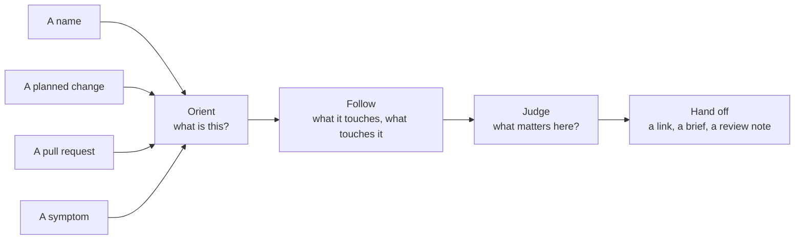

# Users and journeys

Draft, 13 November 2026. Not yet a decision. It records who Woods Map is for,
what each person comes to do, and what they leave with. Page designs should be
checked against it.

## Purpose

Woods gives coding agents the facts Rails resolved. **Woods Map lets a person
see, check and act on those same facts without opening an editor.**

The founding concept:

> Woods Map lets a developer understand a Rails codebase from the facts Rails
> itself resolved, not from reading files. Starting from a name, a change or a
> symptom, it shows the code as it runs, what it touches, what touches it, how
> it got that way and who changed it, and turns that understanding into a link
> anyone can open at the point that matters.

The setting has changed since code was read mostly in editors. People direct
agents, plan work and review changes they did not type. They still need to find
their way around the codebase. Woods Map is where they do that.

## Who it is for

**An engineering team building a SaaS product on Rails.** Not a lone developer,
and not someone who ships without reading code: that person asks an agent.

The team shares one codebase, reviews each other's work and increasingly
directs agents to write it. What one person learns has to reach the others, so
the unit of value is a link or a diagram a teammate can open, in a pull
request, a ticket, a chat thread or an incident note.

| Role on the team | Moment | Comes to | The page fails when |
|---|---|---|---|
| **Tech lead** | Scoping a piece of work | Decide what a change involves and brief a person or an agent | It gives counts, or a claim it cannot back |
| **Reviewer** | A pull request is open | See what the change reaches beyond the diff, before merge | It needs a local lodging, or buries the point in noise |
| **New teammate** | First weeks, or first time in an area | Learn how one part of the product works | It hides the structure behind prose or a wall of rows |
| **On-call engineer** | Something is wrong in production | Find where a symptom comes from, in code they may not own | It has no way in from a symptom, or cannot say who knows the area |

Every reader is a developer who knows Rails and thinks in architecture. The
pages use Rails vocabulary (`before_action`, `perform_later`, `has_many`) and do
not explain it.

The agent is a fifth reader. It receives the link, the diagram or the brief a
person hands over. It reads the output, not the pages.

### What a team needs that one developer does not

- **One shared instance.** Everyone opens the same snapshot of the code, on staging or an internal host.
- **Links that stay true.** A link in a ticket still shows what its author saw.
- **Diagrams that travel.** The same picture renders in a pull request and in a doc.
- **Who knows this.** Recent authors of an area, so a reader knows whom to ask.
- **Boundaries.** Which part of the product a unit belongs to, and where a change crosses into another team's area.

## The spine

Every journey has the same four steps and ends in something to hand on.

## Journeys

### Understand: "How does this work?"

- **Starts from:** a name. A class, a route, a job, a file.
- **Mostly:** New teammate, Tech lead.
- **Orient:** what this is, in one sentence, and where it sits in the application.
- **Follow:** the code as Rails runs it, the request or event it belongs to, what it reads and writes.
- **Judge:** which part is the one the person came for.
- **Hand off:** a link that opens on that part.
- **Done when:** the person can explain it to someone else, or to an agent.

### Plan: "What should the agent watch for?"

- **Starts from:** a change not yet made. A method, a column, an association, not a whole class.
- **Mostly:** Tech lead.
- **Orient:** the thing to be changed and how widely it is used.
- **Follow:** the named units most likely to be affected, grouped by part of the application.
- **Judge:** which of those are risky, and which have no spec.
- **Hand off:** a brief for the agent: scope, units to be careful with, specs to run.
- **Done when:** the person can give the agent direction without reading the code.

### Review: "What does this change reach, and is that covered?"

- **Starts from:** a pull request, before merge. The person arrives by a link in the pull request, not by the start page.
- **Mostly:** Reviewer.
- **Orient:** what changed and why, in the author's words, beside what Woods recorded.
- **Follow:** what the change reaches that the diff does not show.
- **Judge:** what is untested or unexpectedly far from the change.
- **Hand off:** a review note that points at the evidence.
- **Done when:** the person can approve, or say exactly what to fix.

Before merge is the moment that matters: the reviewer can still ask for a spec,
narrow the change or block it. The comparison needs two snapshots in one index,
the base commit and the pull request head (D-2). It can run in CI, on the
author's machine, or both. Both is strongest: the author attaches the report and
CI confirms it.

### Diagnose: "Where could this be going wrong?"

- **Starts from:** a symptom. "The confirmation email did not send."
- **Mostly:** On-call engineer.
- **Orient:** the entry point the symptom belongs to: a route, a job, a mailer.
- **Follow:** the path from that entry point, across background jobs.
- **Judge:** the steps where it could fail, and what changed there recently.
- **Hand off:** a link to the likely spot, with the recent changes beside it.
- **Done when:** the person can point an agent at one place to look.

History is not a journey of its own. "How it got that way and who changed it"
is a question each journey asks at the Judge step.

## What every page owes the reader

1. **The diagram is the answer.** A flowchart or sequence leads the page. One terse line of facts sits above it; prose appears only where a diagram cannot carry the point.
2. **Names before counts.** "Patron, Lodging and 6 more" beats "8 models".
3. **Known, likely and unknown are kept apart.** A fact, an inference and a gap never share one visual weight.
4. **It ends in a hand-off.** Every page offers the link, brief or note its journey produces.
5. **No editor needed.** The line of code is shown where it matters.
6. **Rails vocabulary, terse.** The page names things as the code does. It does not explain Rails, speak for the reader or prescribe a workflow.
7. **Two colour channels, never mixed.** *Kind* (what a unit is: model, controller, view, job) is the bar on a box. *Status* (what happened to it: modified, added, covered, check, gap) is a chip with a glyph. Each channel has its own key and its own tokens (`--kind-*`, `--st-*`), mapped onto the palette in one place, so the palette and its associations can change without touching a page. Text stays light on a dark ground; no light text on a coloured fill.
8. **Lanes are parts of the product.** A diagram groups units by the area they belong to and names who knows it, so a change that crosses into another team's area is visible as a crossing.

## Where today's pages sit

| Journey | Pages that serve it now | Gap |
|---|---|---|
| Understand | Unit page, Passage, Lifecycle, Trail, Landscape | No single answer first; Trail drifts through widely used units |
| Plan | Impact, pre-change mode | Starts from a whole unit; shows counts; no brief to hand on |
| Review | Impact range, saved reports | No entry from a pull request; the page assumes the reader chose the range |
| Diagnose | Search, Trail | Nothing starts from a symptom |

## Open questions

- What does the Review block in a pull request contain, and who writes it: the author's agent, CI, or both?
- How does a symptom become an entry point: search over routes, jobs and mailers, or a guided pick?
- What is the brief for an agent: free text, a structured block, or a link the agent opens through Woods?
